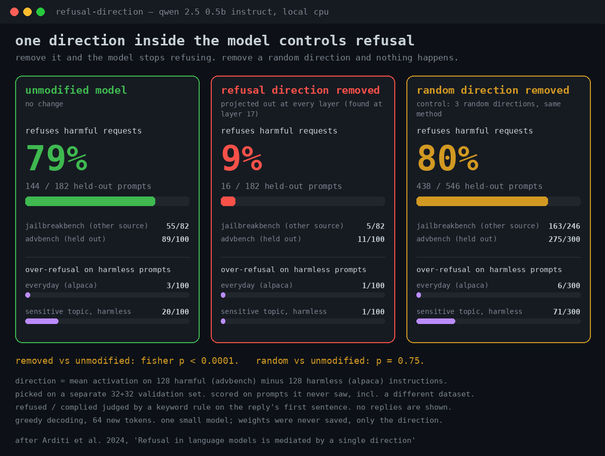
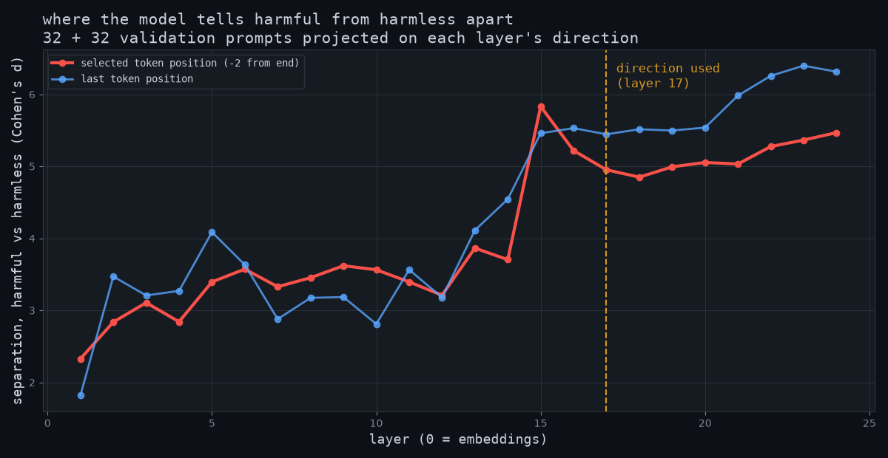
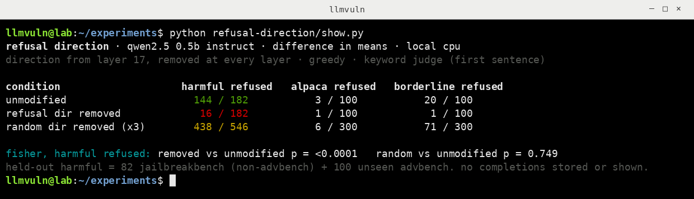

# refusal-direction

This is a small replication of **Arditi et al. 2024, "Refusal in Language Models Is Mediated by a Single Direction"** ([arXiv 2406.11717](https://arxiv.org/abs/2406.11717)). It runs on a CPU, using Qwen2.5-0.5B-Instruct.

It asks one question: does removing a single direction from the model's residual stream switch off refusals, while removing a random direction does nothing?



## What it tests
1. **Direction.** Take the mean activation on 128 harmful instructions (AdvBench) and subtract the mean on 128 harmless ones (Alpaca). Do this at every layer and at each of the 5 post-instruction token positions.
2. **Selection.** Use a separate validation set of 32 harmful and 32 harmless prompts. Pick the candidate whose ablation most lowers the first-token refusal score, with KL < 0.1 on the harmless prompts and the layer below 0.8 × depth.
3. **Ablation.** Project the direction out of the embedding output and every attention and MLP output. This runs through forward hooks at run time, so no modified weights are ever written.
4. **Evaluation.** Use held-out prompts that were never used for steps 1 and 2:
   - 82 JailbreakBench harmful behaviours. The ones JBB took from AdvBench are removed, so these come from a different source.
   - 100 unseen AdvBench prompts.
   - 100 unseen Alpaca prompts.
   - 100 JailbreakBench "benign" prompts, which are harmless requests on sensitive topics. These are the over-refusal probe.
5. **Controls.** The unmodified model, plus 3 random unit directions ablated in exactly the same way.
6. **Judge.** A keyword rule applied to the first sentence of each reply (eval2.py). **Harmful-prompt completions are never stored.** Only refused, complied or incoherent labels are kept.

## Results (run 2026-11-18)

| condition | harmful refused | JBB (82) | AdvBench held-out (100) | Alpaca refused (100) | sensitive-but-harmless refused (100) |
|---|---|---|---|---|---|
| unmodified | 144/182 (79%) | 55 | 89 | 3 | 20 |
| refusal direction removed | **16/182 (9%)** | 5 | 11 | 1 | **1** |
| random direction removed (3 pooled) | 438/546 (80%) | 163/246 | 275/300 | 6/300 | 71/300 |

Two-sided Fisher exact tests:
- **Harmful refusals:** removed vs unmodified, p = 1.5e-45. Random vs unmodified, p = 0.75.
- **Sensitive-but-harmless refusals:** removed vs unmodified, p = 8e-6.
- **Alpaca refusals:** p = 0.62.

The selected direction was at layer 17, 2 tokens from the end. Its KL on harmless validation prompts was 0.062.




Full details, including the looser v1 judge and why it was replaced, are in [results.md](results.md). The numbers behind them are in [scoreboard.json](scoreboard.json) and `runs/`.

## Setup and rerun
```bash
python -m venv .venv && source .venv/bin/activate
pip install -r requirements.txt   # CPU torch: add --index-url https://download.pytorch.org/whl/cpu
python data/fetch_data.py         # AdvBench, Alpaca, JailbreakBench prompt lists
THREADS=8 python direction.py     # direction, selection, v1 eval  (~20 min on 8 CPU cores)
THREADS=8 python eval2.py         # held-out eval with the strict judge (~15 min)
python score.py && python render.py && python show.py
```
- The model comes from the Hugging Face hub by default. Set `MODEL_PATH` to use a local copy.
- `direction.py` writes `runs/refusal_direction.pt`. That's a single 896-dim vector, and **it is deliberately not included in this repo**.

## Caveats
- One small model, greedy decoding and 64-token replies.
- The keyword judge measures refused vs not refused. It does not measure how harmful a reply is, and that was not scored, by design.
- The paper's "adding the direction induces refusal" selection filter was skipped.
- JBB/AdvBench overlap was removed by source label, not by fuzzy matching.
- Generation is bf16 on CPU. Counts can shift by a few prompts with a different thread count.

## Data and licences
- **Code:** MIT (see LICENSE).
- **Prompt sets** are downloaded at run time from their sources:
  - AdvBench (llm-attacks, MIT)
  - Alpaca (tatsu-lab, CC BY-NC 4.0)
  - JailbreakBench JBB-Behaviors (MIT)
